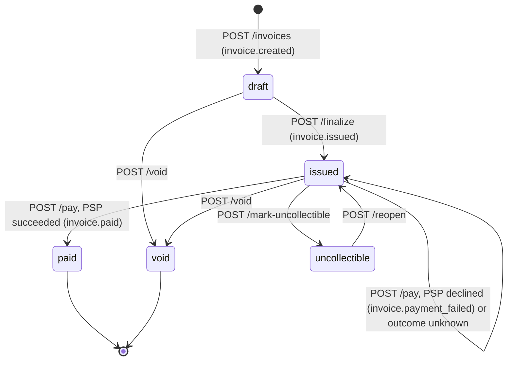

# Design: Invoice & Payment Service

Two Rust (Axum) services plus Postgres:

- `invoice-service`: the API, with migrations embedded in the binary and run on boot, and two background workers running in the same process: webhook delivery and payment reconciliation.
- `mock-psp`: a separate HTTP service, called over the network like a real payments processor.

All money is `i64` / `BIGINT` cents. No float touches the money path.

```
client ──HTTP──▶ invoice-service ──HTTP (5s timeout)──▶ mock-psp
                    │      ▲
              SQL tx│      │poll every 2s
                    ▼      │
                 Postgres ─┘ webhook_deliveries (outbox) ──▶ webhook worker ──signed POST──▶ merchant
```

---

## 1. Data Model

| Table | Key columns | PK / indexes | Why this shape | What changes at 100x scale |
|---|---|---|---|---|
| `businesses` | `name` | UUID | Tenant root. Every other row hangs off it. | Nothing. It stays small and is only read when minting keys. It becomes the shard key if tenants are ever split across databases. |
| `api_keys` | `business_id`, `key_prefix`, `key_hash` (UNIQUE), `revoked` | UUID; partial index on `key_prefix WHERE NOT revoked` | Lookup by non-secret prefix, then verify the hash. A business can hold several keys, which makes rotation possible. | Every request does this lookup, so cache `key_hash → business_id` in-process with a short TTL (~30s). Revocation then needs an explicit cache invalidation (pub/sub) rather than relying on the TTL. |
| `customers` | `business_id`, `name`, `email` | UUID; UNIQUE `(business_id, email)` | Email is unique per business, not globally: two merchants can share a customer. | The list query sorts by `created_at`, which the `(business_id)` index doesn't cover. Replace it with `(business_id, created_at DESC, id)` and use keyset pagination instead of `OFFSET`. |
| `invoices` | `business_id`, `customer_id`, `status` (CHECK), `total_amount_cents` (CHECK ≥ 0), `due_date` | UUID; `(business_id, status)`, `(customer_id)` | `(business_id, status)` serves "list invoices filtered by state", the main read path. | Widen the index to `(business_id, status, created_at DESC)` so the filtered, sorted list is a single index scan with keyset pagination. Switch to UUIDv7 PKs for insert locality. Hash-partition by `business_id` once one table is too big to vacuum comfortably. |
| `line_items` | `invoice_id`, `quantity` (CHECK > 0), `unit_amount_cents`, `line_total_cents` | UUID; `(invoice_id)` | `line_total` and the invoice total are computed server-side and stored. Line items are immutable after creation, so the stored total can't drift from them. | They are immutable and always read together with their invoice. Consider folding them into a JSONB column on `invoices`, which removes a query per read and a table that grows several times faster than invoices. |
| `payment_attempts` | `invoice_id`, `amount_cents`, `status`, `psp_ref`, `failure_code`, `idempotency_key`, `psp_idempotency_key`, `resolution_attempts`, `next_resolution_at`, `resolved_at` | UUID; `(invoice_id, created_at DESC)`; partial `(next_resolution_at) WHERE status IN ('pending','pending_resolution')` | An append-only history of tries. The invoice holds the current state; attempts hold the audit trail. The exact PSP key is stored so the reconciler can look the charge up. The partial index keeps the reconciler's scan to unresolved rows. | Range-partition by `created_at` and move old partitions to cold storage; the history is kept for audit but rarely read. |
| `idempotency_keys` | `request_hash`, `status`, `locked_until`, `response_code`, `response_body` (JSONB) | PK `(business_id, key)` | Scoped per tenant so merchants' keys can't collide. Stores the full response so it can be replayed byte-for-byte. | It grows forever today. Expire keys after 24h by range-partitioning on `created_at` and dropping whole partitions daily. That is cheaper than a mass `DELETE`, which bloats the table. |
| `webhook_endpoints` | `url`, `signing_secret`, `active` | UUID; partial index `(business_id) WHERE active` | A business can register several URLs. Each has its own secret, so one can be rotated or disabled without affecting the others. | It is read inside every state-change transaction (to fan out outbox rows). Cache active endpoints per business to keep that read out of the hot path. |
| `webhook_deliveries` | `event_type`, `payload`, `status`, `attempt_count`, `next_retry_at`, `last_error` | UUID; partial index `(status, next_retry_at) WHERE status='pending'` | The outbox. The partial index keeps the worker's poll cheap even when the table is mostly `delivered` rows. | The largest table: one row per event per endpoint. Partition by month and drop delivered rows after N days. Run several workers that claim rows inside a transaction (`FOR UPDATE SKIP LOCKED`), and deliver concurrently per endpoint. At higher volume, relay the outbox into a queue (SQS/Kafka) and deliver from there. |

**Primary keys** are UUIDs generated by Postgres (`gen_random_uuid()`). IDs are not enumerable (`/invoices/2` reveals nothing) and need no coordination.

**Status columns** are `VARCHAR` + `CHECK` rather than Postgres `ENUM`: the same integrity guarantee, but adding or removing a value is a one-line migration instead of an enum rewrite.

**Tenant isolation is in the SQL.** Every query filters `AND business_id = $n`, so another tenant's invoice returns 404, not 403, and its existence isn't revealed.

**At 100x scale, across all tables:**
- Use UUIDv7 (time-ordered) PKs on the insert-heavy tables. Random v4 UUIDs scatter inserts across the B-tree.
- Route list and GET endpoints to a read replica. Writes and payment locks stay on the primary.
- Put PgBouncer (transaction pooling) in front of Postgres and size the pool deliberately. Payments no longer hold a connection during the PSP call (see §3), but every payment still makes three short transactions.

---

## 2. Invoice State Machine



- **Terminal:** `paid` and `void`. They have no outgoing transitions.
- **Reversible:** only `uncollectible → issued`. A write-off is an accounting judgement that can be undone if the customer later pays. `paid` can't be reversed without refunds, which are out of scope. `void` is final by definition.
- **A declined payment does not change state.** The invoice stays `issued` and can be retried with another card. Failure is recorded on the `payment_attempt`, not the invoice.
- **Only `issued` invoices are payable.** `draft` is still editable in principle, and `uncollectible` must be reopened first.
- **An unresolved payment pins the invoice to `issued`.** While an attempt is `pending` or `pending_resolution`, `/pay`, `/void` and `/mark-uncollectible` return `409 payment_pending`. The charge may still succeed, and the invoice must still be payable when it does.

**How invalid transitions are rejected:** the transitions live in one function, `InvoiceStatus::valid_transitions()` (`models.rs`). Each transition endpoint locks the row (`SELECT … FOR UPDATE`), checks `can_transition_to`, and otherwise returns:

```json
409 {"error":"invalid_state_transition","message":"Cannot transition invoice from 'paid' to 'void'",
     "current_state":"paid","requested_state":"void"}
```

The lock makes check-then-update atomic, so a `void` cannot race a `pay`. The DB `CHECK` constraint is a backstop on valid *values*. Transitions are enforced in the application.

---

## 3. Payment Correctness & Failure Modes

**Mechanism: a committed `pending` attempt acts as the claim on the invoice. It is created under a row lock (`SELECT … FOR UPDATE` on the invoice), and an idempotency-key table sits in front.** The lock and the "at most one unresolved attempt" rule prevent concurrent double charges. The idempotency table makes retries safe. A reconciler resolves attempts whose outcome is unknown.

The `/pay` flow:

1. Look up `(business_id, Idempotency-Key)`. If it's completed with the same request hash, replay the stored response.
2. Upsert the key as `processing` with `locked_until = now + 30s`.
3. `BEGIN`, then `SELECT invoice … FOR UPDATE`. Reject unless the invoice is `issued` (`409 invalid_state_transition`) and has no `pending`/`pending_resolution` attempt (`409 payment_pending`).
4. Insert a `pending` payment attempt and `COMMIT`. The lock is released, but the committed attempt now blocks every other payment on the invoice.
5. Call the PSP with a 5s timeout, passing `"{invoice_id}-{idempotency_key}"` as the PSP's idempotency key. No DB connection is held during the call.
6. On a definite answer, a second transaction locks the invoice, moves the attempt to `succeeded`/`failed` (only if it is still unresolved), marks the invoice `paid` on success, writes the webhook outbox row and commits. The response is then stored against the key.
7. On a timeout, network error, 5xx or malformed body, the attempt becomes `pending_resolution` and is left for the reconciler (3b).

**Why not the alternatives?** The defining constraint is the external side effect: the decision to charge must be serialized *before* the PSP is called.

- *Optimistic concurrency* (a version column) and *status-conditional `UPDATE … WHERE status='issued'`* detect the conflict only when writing the result. By then both requests have already charged the card.
- *SERIALIZABLE isolation* has the same flaw: the losing transaction aborts after its PSP call.
- *Advisory locks* would work equally well, but they live outside the schema, so a row lock on the invoice is simpler and self-documenting.

The row lock is held only for the claim in step 4 and the result in step 6, not across the PSP call, so slow PSP calls can't exhaust the connection pool. The cost is that a crash between steps 4 and 6 leaves a `pending` row behind. The reconciler adopts such rows (3c).

**(a) Two simultaneous `POST /pay` for the same invoice.** One request acquires the row lock, commits its `pending` attempt and calls the PSP. The other was blocked on `SELECT … FOR UPDATE`. When it gets the lock it finds the unresolved attempt and returns `409 payment_pending`, or `409 invalid_state_transition` if the first has already marked the invoice `paid`. Either way it never touches the PSP.

This holds whether or not the two requests share an idempotency key. It's verified by `concurrent_payments_charge_exactly_once`: 8 concurrent requests with distinct keys produce one 200, seven 409s, one `succeeded` attempt, and exactly one PSP call (asserted with wiremock).

**(b) PSP times out (`tok_timeout`, 30s).** The HTTP client gives up after 5s, so the endpoint doesn't hang. Because the outcome is *unknown* (the PSP may have charged), we neither mark the invoice paid nor mark the attempt failed. The committed attempt moves to `pending_resolution` with its first lookup scheduled 30s later, the invoice stays `issued`, and the response is:

```json
504 {"error":"psp_timeout","message":"…pending resolution","payment_attempt_id":"…"}
```

`tok_network_error` (PSP 500) and malformed PSP responses take the same path. This is verified by `psp_timeout_leaves_invoice_issued` and `psp_network_error_leaves_invoice_issued`.

**Blocking.** Until the attempt is resolved, `/pay` with any key returns `409 payment_pending` (with the blocking `payment_attempt_id`), and so do `/void` and `/mark-uncollectible`. A retry with a **new** key therefore can't charge a second time. Covered by `unresolved_attempt_blocks_new_payments_and_transitions`.

**Reconciliation** (`reconciliation.rs`). A worker in the same process polls every 10s:

- It claims due rows with `UPDATE … WHERE id IN (SELECT … FOR UPDATE SKIP LOCKED) RETURNING *`, pushing `next_resolution_at` forward as a 60s lease. That makes it safe to run on several replicas.
- For each row it calls the PSP's `GET /charges/{psp_idempotency_key}`:
  - `succeeded`: the attempt becomes `succeeded`, the invoice `paid`, and `invoice.paid` is emitted.
  - `failed`: the attempt becomes `failed` and `invoice.payment_failed` is emitted.
  - `404`: the PSP never received the charge. The attempt becomes `failed` with `failure_code: psp_no_charge`, and the invoice is payable again.
  - `processing`, a 5xx or a network error: retry after 30s, 1m, 5m, 15m, then every hour. From the fifth inconclusive lookup each retry is logged at error level for manual review. The invoice stays blocked: guessing would either lose money or double-charge.
- Each resolution runs in one transaction with the same lock order as `/pay`, invoice then attempt. It only updates an attempt that is still unresolved, so the reconciler and a late `/pay` response can't both apply an outcome.

**How the caller learns the result:** the `invoice.paid` / `invoice.payment_failed` webhook, or polling `GET /payment-attempts/{id}` with the id from the 504. A same-key retry still replays the stored 504 byte-for-byte, as idempotency requires. Covered by `reconciler_marks_invoice_paid_when_psp_charged`, `reconciler_fails_attempt_when_psp_has_no_charge` and `reconciler_backs_off_while_psp_cannot_answer`.

**A 404 trusts the PSP to have recorded the request on arrival.** The first lookup waits 30s, which is far longer than any request could be in transit, so a 404 means the charge was never received. The mock PSP records `processing` as soon as a charge arrives.

**(c) PSP succeeds, then the service crashes before persisting.** The `pending` attempt was committed before the PSP call, so it survives the crash, and the invoice stays blocked. The reconciler adopts any `pending` attempt older than 2 minutes (well past the 5s PSP timeout, so it never races a live request). It looks the charge up and marks the invoice `paid`. Covered by `reconciler_adopts_attempt_abandoned_by_crash`.

- **Retry with the same key within 30s:** `409 concurrent_request`.
- **Retry with any key after that, before reconciliation:** `409 payment_pending`.
- **After reconciliation:** `409 invalid_state_transition` (`paid`), and the PSP was called once.

A DB error while recording a definite PSP answer takes the same path. The handler returns `500` with the `payment_attempt_id`, the attempt stays `pending`, and the reconciler resolves it.

**(d) Idempotency key reused with a different body.** The request fingerprint is `SHA-256(card_token:invoice_id)`. A completed key whose stored hash differs returns `422 idempotency_key_mismatch`, and nothing is charged. We reject instead of replaying, because replaying would tell the client its *new* request succeeded when it never ran. Covered in `retried_payment_with_same_key_replays_response`.

**(e) `POST /pay` on a `paid` invoice.** With a new key, the state check under the lock returns `409 invalid_state_transition` (`current_state: paid`), and the PSP is never called. With the key that originally paid it, the original 200 response is replayed. That is correct: it's the same request.

---

## 4. Webhook Design

**Decoupling (transactional outbox):**

- A handler that changes state inserts a `webhook_deliveries` row per active endpoint **in the same transaction** as the change. The event is committed iff the state change is, so there is no dual-write gap.
- The response returns immediately. A Tokio task started at boot polls every 2s, picks up due `pending` rows (batch of 50), and POSTs each one with a 10s timeout.
- A slow or dead merchant endpoint therefore never adds latency to the API, and no extra infrastructure (Redis/RabbitMQ) is needed.

**Events:** `invoice.created`, `invoice.issued`, `invoice.paid`, `invoice.payment_failed`.

**Signing:**
```
Dodo-Signature: t=<unix_ts>,v1=<hex HMAC-SHA256(endpoint_secret, "<unix_ts>.<raw_body>")>
Dodo-Webhook-Id: <delivery uuid>
Dodo-Webhook-Timestamp: <unix_ts>
```

- **Integrity and authenticity:** the timestamp is inside the signed content, so it can't be altered.
- **Replay protection** is the receiver's job: reject a `t` older than about 5 minutes, and dedupe on `Dodo-Webhook-Id`. Delivery is at-least-once.
- **The secret** is 128-bit random and generated per endpoint. It's stored in plaintext because HMAC needs it, unlike API keys.

**Retry policy:** up to 6 attempts. After failures 1 to 5 the next attempt is scheduled 30s, 2m, 15m, 1h and 4h later, for a total budget of about 5h17m. Any non-2xx or network error counts as a failure.

**Exhausted retries:** the row is marked `failed` with `last_error` kept. It isn't deleted.

**Reconciliation:**
- Webhooks are notifications. The invoice is the source of truth, and businesses can reconcile with `GET /invoices?status=paid`.
- A redelivery endpoint for `failed` rows and a "list events since X" endpoint are cut (§6).

**Known limitations:**
- Deliveries are sent sequentially, so one slow endpoint delays others.
- `FOR UPDATE SKIP LOCKED` is used outside a transaction, so it doesn't claim rows. This is safe with one instance, but running several replicas would need the claim done in a transaction (or an `UPDATE … RETURNING` claim).

---

## 5. API Key Model

- **Generation:** `dodo_live_` + 32 characters from a 62-symbol alphabet using a CSPRNG (about 190 bits of entropy).
- **Storage:** never in plaintext. We store `key_prefix` (the first 8 random characters, non-secret, indexed) and `SHA-256(full_key)`. The raw key is returned exactly once, at creation.
  - SHA-256 rather than bcrypt/argon2: slow hashes exist to protect *low-entropy* secrets like passwords. A 190-bit random key can't be brute-forced, and a slow hash would add tens of milliseconds to every authenticated request.
- **Transmission:** `Authorization: Bearer <key>`. TLS is assumed to terminate at a load balancer in front of the service. `docker compose` here is plain HTTP for local use.
- **Authentication:** look up non-revoked keys by prefix, compare hashes, and resolve `business_id`, which then scopes every query.
- **Rotation:** a business can hold several active keys, so the flow is: create a new key, deploy it, then revoke the old one. No downtime is needed.
- **Revocation:** the `revoked`/`revoked_at` columns exist and authentication honours them immediately, with no cache. **The revoke endpoint was cut**, so today revocation means a SQL update.
- **Blast radius if leaked:** full API access for *that one business* and no other tenant. An attacker could read customers and invoices, create invoices, trigger charges on payable invoices, and register a webhook endpoint to receive future events. There are no scopes and no expiry.
- **Bootstrap caveat:** `POST /businesses` and `POST /businesses/{id}/api-keys` are unauthenticated so the demo works with plain `curl`. Anyone who knows a business id can mint a key. In production this would sit behind dashboard auth.

---

## 6. What I Cut and Why

1. **Key revocation endpoint and scoped keys.** The schema supports revocation, but the endpoint was lower value than payment correctness within the time budget.
2. **Webhook redelivery / event-listing endpoints.** The invoice API is sufficient for reconciliation at this scale.
3. **Editing draft invoices** (adding or removing line items). Invoices are immutable after creation, which keeps the stored total trivially consistent with its line items.
4. **Refunds and partial payments** (out of scope). These would add a `refunds` table referencing `payment_attempts`, and an amount-paid ledger on the invoice instead of the binary `paid` state.

---

## 7. Production Readiness Gap

1. **Payment robustness.**
   - The `GET /charges/{idempotency_key}` lookup the reconciler uses is modelled on what real PSPs offer, but it isn't part of the assignment's mock PSP spec. A real integration would map it onto that PSP's actual lookup API.
   - An attempt the PSP can never answer for keeps the invoice blocked indefinitely, by design. Operations needs an authenticated endpoint to resolve it manually after checking the PSP dashboard.
   - A charge that succeeds on an invoice that is no longer payable is only logged. That can't happen today, because transitions are blocked while a charge is in flight, but it should open a refund case automatically.
2. **Observability.** There are structured logs (`tracing`) but no metrics or alerts. The essentials are PSP latency and error rate, count and age of `pending_resolution` attempts (today only logged, at error level after five inconclusive lookups), webhook backlog and failure rate, DB pool saturation, and request IDs propagated into the PSP and webhook calls.
3. **Abuse controls and audit.**
   - Per-API-key rate limiting: a token bucket in Redis, or at the gateway, with a stricter limit on `/pay`.
   - Authentication on the bootstrap endpoints.
   - An append-only audit log of state transitions recording who/which key acted and when, which is required to answer "why is this invoice void?"
