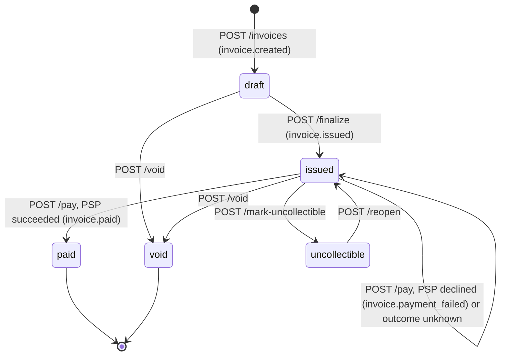

# Design: Invoice & Payment Service

Two Rust (Axum) services plus Postgres:

- `invoice-service`: the API, with migrations embedded in the binary and run on boot, and a background webhook worker running in the same process.
- `mock-psp`: a separate HTTP service, called over the network like a real payments processor.

All money is `i64` / `BIGINT` cents. No float touches the money path.

```
client ──HTTP──▶ invoice-service ──HTTP (5s timeout)──▶ mock-psp
                    │      ▲
              SQL tx│      │poll every 2s
                    ▼      │
                 Postgres ─┘ webhook_deliveries (outbox) ──▶ webhook worker ──signed POST──▶ merchant
```

---

## 1. Data Model

| Table | Key columns | PK / indexes | Why this shape | What changes at 100x scale |
|---|---|---|---|---|
| `businesses` | `name` | UUID | Tenant root. Every other row hangs off it. | Nothing. It stays small and is only read when minting keys. It becomes the shard key if tenants are ever split across databases. |
| `api_keys` | `business_id`, `key_prefix`, `key_hash` (UNIQUE), `revoked` | UUID; partial index on `key_prefix WHERE NOT revoked` | Lookup by non-secret prefix, then verify the hash. A business can hold several keys, which makes rotation possible. | Every request does this lookup, so cache `key_hash → business_id` in-process with a short TTL (~30s). Revocation then needs an explicit cache invalidation (pub/sub) rather than relying on the TTL. |
| `customers` | `business_id`, `name`, `email` | UUID; UNIQUE `(business_id, email)` | Email is unique per business, not globally: two merchants can share a customer. | The list query sorts by `created_at`, which the `(business_id)` index doesn't cover. Replace it with `(business_id, created_at DESC, id)` and use keyset pagination instead of `OFFSET`. |
| `invoices` | `business_id`, `customer_id`, `status` (CHECK), `total_amount_cents` (CHECK ≥ 0), `due_date` | UUID; `(business_id, status)`, `(customer_id)` | `(business_id, status)` serves "list invoices filtered by state", the main read path. | Widen the index to `(business_id, status, created_at DESC)` so the filtered, sorted list is a single index scan with keyset pagination. Switch to UUIDv7 PKs for insert locality. Hash-partition by `business_id` once one table is too big to vacuum comfortably. |
| `line_items` | `invoice_id`, `quantity` (CHECK > 0), `unit_amount_cents`, `line_total_cents` | UUID; `(invoice_id)` | `line_total` and the invoice total are computed server-side and stored. Line items are immutable after creation, so the stored total can't drift from them. | They are immutable and always read together with their invoice. Consider folding them into a JSONB column on `invoices`, which removes a query per read and a table that grows several times faster than invoices. |
| `payment_attempts` | `invoice_id`, `amount_cents`, `status`, `psp_ref`, `failure_code`, `idempotency_key` | UUID; `(invoice_id, created_at DESC)` | An append-only history of tries. The invoice holds the current state; attempts hold the audit trail. | Add a partial index `WHERE status = 'pending_resolution'` so the reconciler's scan stays tiny. Range-partition by `created_at` and move old partitions to cold storage; the history is kept for audit but rarely read. |
| `idempotency_keys` | `request_hash`, `status`, `locked_until`, `response_code`, `response_body` (JSONB) | PK `(business_id, key)` | Scoped per tenant so merchants' keys can't collide. Stores the full response so it can be replayed byte-for-byte. | It grows forever today. Expire keys after 24h by range-partitioning on `created_at` and dropping whole partitions daily. That is cheaper than a mass `DELETE`, which bloats the table. |
| `webhook_endpoints` | `url`, `signing_secret`, `active` | UUID; partial index `(business_id) WHERE active` | A business can register several URLs. Each has its own secret, so one can be rotated or disabled without affecting the others. | It is read inside every state-change transaction (to fan out outbox rows). Cache active endpoints per business to keep that read out of the hot path. |
| `webhook_deliveries` | `event_type`, `payload`, `status`, `attempt_count`, `next_retry_at`, `last_error` | UUID; partial index `(status, next_retry_at) WHERE status='pending'` | The outbox. The partial index keeps the worker's poll cheap even when the table is mostly `delivered` rows. | The largest table: one row per event per endpoint. Partition by month and drop delivered rows after N days. Run several workers that claim rows inside a transaction (`FOR UPDATE SKIP LOCKED`), and deliver concurrently per endpoint. At higher volume, relay the outbox into a queue (SQS/Kafka) and deliver from there. |

**Primary keys** are UUIDs generated by Postgres (`gen_random_uuid()`). IDs are not enumerable (`/invoices/2` reveals nothing) and need no coordination.

**Status columns** are `VARCHAR` + `CHECK` rather than Postgres `ENUM`: the same integrity guarantee, but adding or removing a value is a one-line migration instead of an enum rewrite.

**Tenant isolation is in the SQL.** Every query filters `AND business_id = $n`, so another tenant's invoice returns 404, not 403, and its existence isn't revealed.

**At 100x scale, across all tables:**
- Use UUIDv7 (time-ordered) PKs on the insert-heavy tables. Random v4 UUIDs scatter inserts across the B-tree.
- Route list and GET endpoints to a read replica. Writes and payment locks stay on the primary.
- Put PgBouncer (transaction pooling) in front of Postgres and size the pool deliberately. Payments hold a connection for the PSP's latency (see 3a), so pool exhaustion arrives before CPU limits.

---

## 2. Invoice State Machine



- **Terminal:** `paid` and `void`. They have no outgoing transitions.
- **Reversible:** only `uncollectible → issued`. A write-off is an accounting judgement that can be undone if the customer later pays. `paid` can't be reversed without refunds, which are out of scope. `void` is final by definition.
- **A declined payment does not change state.** The invoice stays `issued` and can be retried with another card. Failure is recorded on the `payment_attempt`, not the invoice.
- **Only `issued` invoices are payable.** `draft` is still editable in principle, and `uncollectible` must be reopened first.

**How invalid transitions are rejected:** the transitions live in one function, `InvoiceStatus::valid_transitions()` (`models.rs`). Each transition endpoint locks the row (`SELECT … FOR UPDATE`), checks `can_transition_to`, and otherwise returns:

```json
409 {"error":"invalid_state_transition","message":"Cannot transition invoice from 'paid' to 'void'",
     "current_state":"paid","requested_state":"void"}
```

The lock makes check-then-update atomic, so a `void` cannot race a `pay`. The DB `CHECK` constraint is a backstop on valid *values*. Transitions are enforced in the application.

---

## 3. Payment Correctness & Failure Modes

**Mechanism: a pessimistic row lock (`SELECT … FOR UPDATE` on the invoice), held across the PSP call, plus an idempotency-key table.** The lock prevents concurrent double charges. The idempotency table makes retries safe.

The `/pay` flow:

1. Look up `(business_id, Idempotency-Key)`. If it's completed with the same request hash, replay the stored response.
2. Upsert the key as `processing` with `locked_until = now + 30s`.
3. `BEGIN`, then `SELECT invoice … FOR UPDATE`. Reject unless the invoice is `issued`.
4. Insert a `pending` payment attempt.
5. Call the PSP with a 5s timeout, passing `"{invoice_id}-{idempotency_key}"` as the PSP's idempotency key.
6. On a definite answer, update the attempt and invoice, write the webhook outbox row, `COMMIT`, then store the response against the key.

**Why not the alternatives?** The defining constraint is the external side effect: the decision to charge must be serialized *before* the PSP is called.

- *Optimistic concurrency* (a version column) and *status-conditional `UPDATE … WHERE status='issued'`* detect the conflict only when writing the result. By then both requests have already charged the card.
- *SERIALIZABLE isolation* has the same flaw: the losing transaction aborts after its PSP call.
- *Advisory locks* would work equally well, but they live outside the schema, so a row lock on the invoice is simpler and self-documenting.
- The serious alternative is a committed intermediate `payment_processing` state, which claims the invoice without holding a lock across the network. It is noted in §7.

The cost of this choice is that a DB connection and the row lock are held for up to 5s per payment. With a pool of 20, twenty simultaneous slow PSP calls would starve the API.

**(a) Two simultaneous `POST /pay` for the same invoice.** One request acquires the row lock and the other blocks on `SELECT … FOR UPDATE`. The first charges, sets `paid` and commits. The second then reads `paid` and gets `409 invalid_state_transition` without touching the PSP.

This holds whether or not the two requests share an idempotency key. It's verified by `concurrent_payments_charge_exactly_once`: 8 concurrent requests with distinct keys produce one 200, seven 409s, one `succeeded` attempt, and exactly one PSP call (asserted with wiremock).

**(b) PSP times out (`tok_timeout`, 30s).** The HTTP client gives up after 5s, so the endpoint doesn't hang. Because the outcome is *unknown* (the PSP may have charged), we neither mark the invoice paid nor mark the attempt failed. The transaction rolls back, a `payment_attempt` with status `pending_resolution` is recorded, the invoice stays `issued`, and the response is:

```json
504 {"error":"psp_timeout","message":"…pending resolution","payment_attempt_id":"…"}
```

`tok_network_error` (PSP 500) and malformed PSP responses take the same path. This is verified by `psp_timeout_leaves_invoice_issued` and `psp_network_error_leaves_invoice_issued`.

*How the caller learns the eventual result: in this build, it can't yet.* There is no reconciliation job, and a same-key retry replays the stored 504. The intended design, which I cut for time:

- A worker periodically queries the PSP by the idempotency key we sent for each `pending_resolution` attempt.
- It resolves the attempt to `succeeded`/`failed`. On success it moves the invoice to `paid` and emits `invoice.paid`, so the merchant learns via webhook.
- Until resolved, `/pay` should reject new attempts on that invoice (`409 payment_pending`). Today it does not, so a retry with a **new** key could charge a second time. This is the most important known gap.

**(c) PSP succeeds, then the service crashes before persisting.** The open transaction dies with the connection. Postgres rolls back the `pending` attempt and the invoice stays `issued`. The idempotency row was committed earlier as `processing`.

- **Retry with the same key within 30s:** `409 concurrent_request`.
- **Retry with the same key after `locked_until` expires:** the request proceeds and calls the PSP again with the **same** PSP idempotency key (`{invoice_id}-{key}`). A real PSP deduplicates on that key and returns the original charge instead of creating a new one, so the invoice is marked `paid` with one charge. The mock PSP does not implement this deduplication.
- **Retry with a different key:** this is a new PSP key, so the customer could be charged twice.

The fix is to commit the `pending` attempt *before* calling the PSP. Then a crash leaves a durable record for the reconciler from (b) to resolve, rather than no trace.

**(d) Idempotency key reused with a different body.** The request fingerprint is `SHA-256(card_token:invoice_id)`. A completed key whose stored hash differs returns `422 idempotency_key_mismatch`, and nothing is charged. We reject instead of replaying, because replaying would tell the client its *new* request succeeded when it never ran. Covered in `retried_payment_with_same_key_replays_response`.

**(e) `POST /pay` on a `paid` invoice.** With a new key, the state check under the lock returns `409 invalid_state_transition` (`current_state: paid`), and the PSP is never called. With the key that originally paid it, the original 200 response is replayed. That is correct: it's the same request.

---

## 4. Webhook Design

**Decoupling (transactional outbox):**

- A handler that changes state inserts a `webhook_deliveries` row per active endpoint **in the same transaction** as the change. The event is committed iff the state change is, so there is no dual-write gap.
- The response returns immediately. A Tokio task started at boot polls every 2s, picks up due `pending` rows (batch of 50), and POSTs each one with a 10s timeout.
- A slow or dead merchant endpoint therefore never adds latency to the API, and no extra infrastructure (Redis/RabbitMQ) is needed.

**Events:** `invoice.created`, `invoice.issued`, `invoice.paid`, `invoice.payment_failed`.

**Signing:**
```
Dodo-Signature: t=<unix_ts>,v1=<hex HMAC-SHA256(endpoint_secret, "<unix_ts>.<raw_body>")>
Dodo-Webhook-Id: <delivery uuid>
Dodo-Webhook-Timestamp: <unix_ts>
```

- **Integrity and authenticity:** the timestamp is inside the signed content, so it can't be altered.
- **Replay protection** is the receiver's job: reject a `t` older than about 5 minutes, and dedupe on `Dodo-Webhook-Id`. Delivery is at-least-once.
- **The secret** is 128-bit random and generated per endpoint. It's stored in plaintext because HMAC needs it, unlike API keys.

**Retry policy:** up to 6 attempts. After failures 1 to 5 the next attempt is scheduled 30s, 2m, 15m, 1h and 4h later, for a total budget of about 5h17m. Any non-2xx or network error counts as a failure.

**Exhausted retries:** the row is marked `failed` with `last_error` kept. It isn't deleted.

**Reconciliation:**
- Webhooks are notifications. The invoice is the source of truth, and businesses can reconcile with `GET /invoices?status=paid`.
- A redelivery endpoint for `failed` rows and a "list events since X" endpoint are cut (§6).

**Known limitations:**
- Deliveries are sent sequentially, so one slow endpoint delays others.
- `FOR UPDATE SKIP LOCKED` is used outside a transaction, so it doesn't claim rows. This is safe with one instance, but running several replicas would need the claim done in a transaction (or an `UPDATE … RETURNING` claim).

---

## 5. API Key Model

- **Generation:** `dodo_live_` + 32 characters from a 62-symbol alphabet using a CSPRNG (about 190 bits of entropy).
- **Storage:** never in plaintext. We store `key_prefix` (the first 8 random characters, non-secret, indexed) and `SHA-256(full_key)`. The raw key is returned exactly once, at creation.
  - SHA-256 rather than bcrypt/argon2: slow hashes exist to protect *low-entropy* secrets like passwords. A 190-bit random key can't be brute-forced, and a slow hash would add tens of milliseconds to every authenticated request.
- **Transmission:** `Authorization: Bearer <key>`. TLS is assumed to terminate at a load balancer in front of the service. `docker compose` here is plain HTTP for local use.
- **Authentication:** look up non-revoked keys by prefix, compare hashes, and resolve `business_id`, which then scopes every query.
- **Rotation:** a business can hold several active keys, so the flow is: create a new key, deploy it, then revoke the old one. No downtime is needed.
- **Revocation:** the `revoked`/`revoked_at` columns exist and authentication honours them immediately, with no cache. **The revoke endpoint was cut**, so today revocation means a SQL update.
- **Blast radius if leaked:** full API access for *that one business* and no other tenant. An attacker could read customers and invoices, create invoices, trigger charges on payable invoices, and register a webhook endpoint to receive future events. There are no scopes and no expiry.
- **Bootstrap caveat:** `POST /businesses` and `POST /businesses/{id}/api-keys` are unauthenticated so the demo works with plain `curl`. Anyone who knows a business id can mint a key. In production this would sit behind dashboard auth.

---

## 6. What I Cut and Why

1. **Payment reconciliation worker** for `pending_resolution` attempts (see 3b/3c). It is the right fix for unknown outcomes, but it needs a PSP "lookup by idempotency key" API that the spec's mock doesn't define. I prioritized not corrupting state over resolving it automatically.
2. **Key revocation endpoint and scoped keys.** The schema supports revocation, but the endpoint was lower value than payment correctness within the time budget.
3. **Webhook redelivery / event-listing endpoints.** The invoice API is sufficient for reconciliation at this scale.
4. **Editing draft invoices** (adding or removing line items). Invoices are immutable after creation, which keeps the stored total trivially consistent with its line items.
5. **Refunds and partial payments** (out of scope). These would add a `refunds` table referencing `payment_attempts`, and an amount-paid ledger on the invoice instead of the binary `paid` state.

---

## 7. Production Readiness Gap

1. **Payment robustness.**
   - Commit the attempt *before* the PSP call.
   - Replace the lock-across-network with a committed `payment_processing` claim, so DB connections aren't held for the PSP's latency.
   - Add the reconciler and block new attempts while one is `pending_resolution`.
   - Remove the remaining `.unwrap()`s on DB writes after a successful charge. A DB error there currently drops the connection instead of returning a 500, leaving the case in 3(c).
2. **Observability.** There are structured logs (`tracing`) but no metrics or alerts. The essentials are PSP latency and error rate, count and age of `pending_resolution` attempts, webhook backlog and failure rate, DB pool saturation, and request IDs propagated into the PSP and webhook calls.
3. **Abuse controls and audit.**
   - Per-API-key rate limiting: a token bucket in Redis, or at the gateway, with a stricter limit on `/pay`.
   - Authentication on the bootstrap endpoints.
   - An append-only audit log of state transitions recording who/which key acted and when, which is required to answer "why is this invoice void?"
